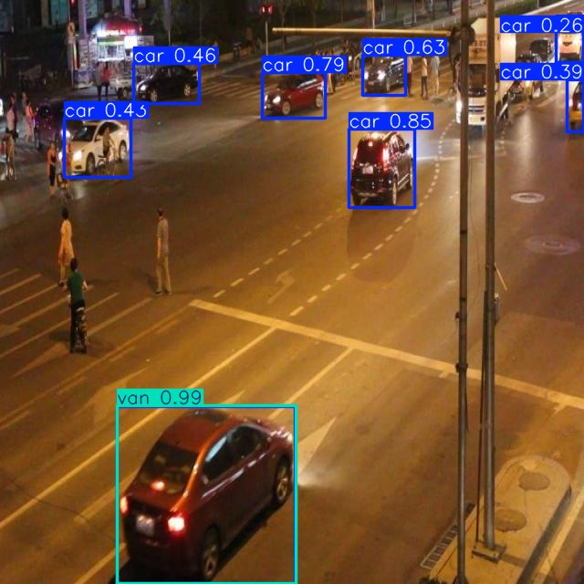
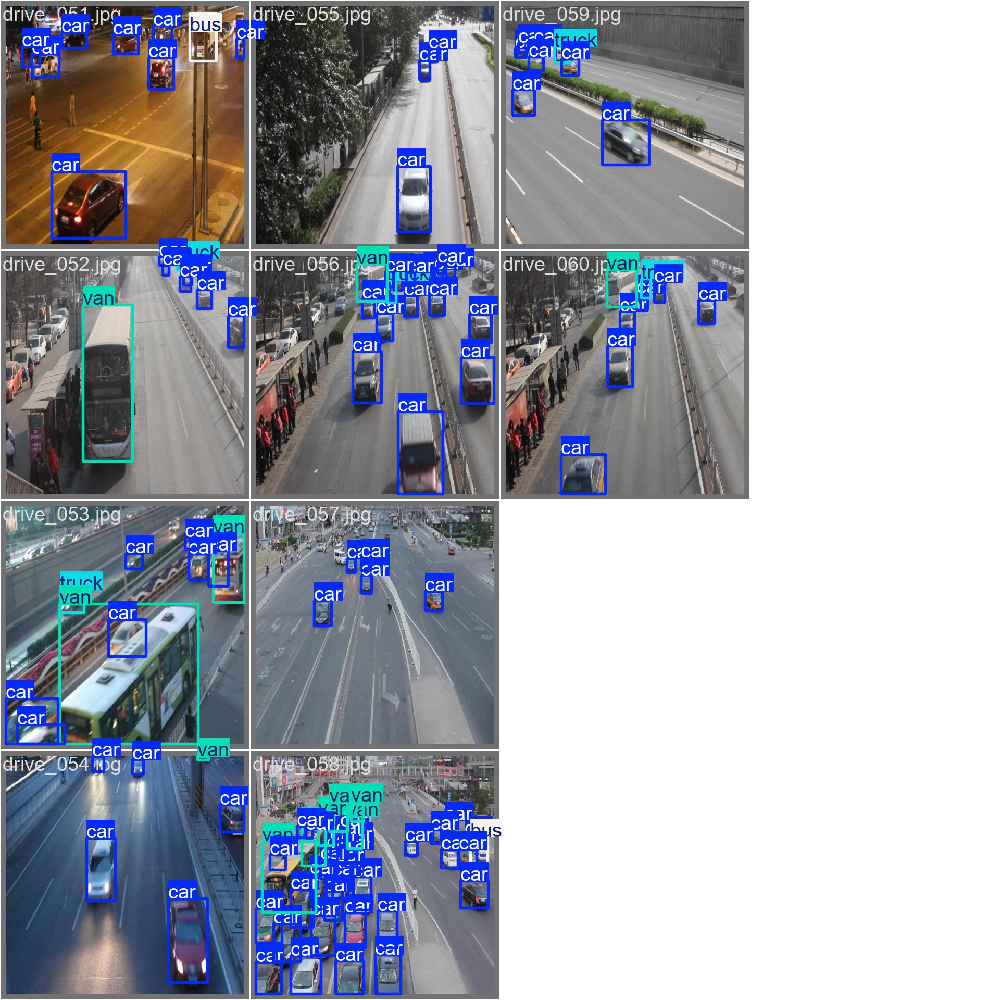
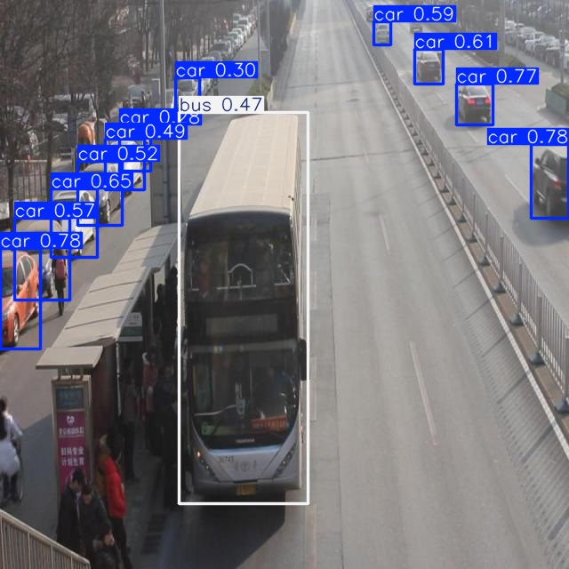

# Báo cáo cá nhân — Ngày 2 Object Detection

Đổi tên file theo `MSSV_HoTen.md`, ví dụ `20241234_NguyenVanAn.md`. Điền kết quả thật, xóa dòng hướng dẫn khi nộp. Xem [quy định nộp](../../SUBMISSION.md).

## 1. Thông tin học viên

- Họ tên: Lê Việt Long
- MSSV: 2A202603043
- Email: longtk292@gmail.com / 26ai.longlv3@vinuni.edu.vn
- Lớp: Khóa V - Level 2-3
- Link repo bài làm: https://github.com/DragVN04/K5-L2A-LeVietLong-2A202603043
- Link Colab đã chạy: [K5-L2A-LeVietLong-2A202603043/blob/main/notebooks/day2_annotation_to_yolo.ipynb](https://colab.research.google.com/github/DragVN04/K5-L2A-LeVietLong-2A202603043/blob/main/notebooks/day2_annotation_to_yolo.ipynb)

## 2. Schema và mini guideline

Trong bài lab này, em thực hiện gán nhãn các đối tượng trong ảnh bằng bounding box theo định dạng YOLO. Mỗi đối tượng được xác định bằng class và tọa độ bounding box.
Em sử dụng file GUIDELINE_MINI.md để ghi lại các quy tắc gán nhãn.

Trong quá trình thực hiện, em gặp một số trường hợp cần chú ý:

1. Đối tượng bị mờ: Một số vật thể trong ảnh không có ranh giới rõ ràng nên việc xác định bounding box khá khó khăn. Em cần cân nhắc vùng thực sự thuộc đối tượng thay vì chỉ lấy phần rõ nhất.
2. Đối tượng bị che khuất: Có trường hợp các vật thể nằm chồng lên nhau hoặc bị che mất một phần. Điều này gây khó khăn khi xác định kích thước và giới hạn của bounding box.
3. Đối tượng nhỏ hoặc ở xa: Một số vật thể có kích thước nhỏ, khó phân biệt class và dễ bị gán nhãn không chính xác.

Điều em nhận thấy là việc gán nhãn không chỉ đơn giản là vẽ box quanh vật thể mà còn cần áp dụng thống nhất các quy tắc của guideline.

Phần em muốn được làm rõ thêm là cách xử lý đối tượng bị che khuất nhiều, vật thể quá mờ và trường hợp nào nên bỏ qua thay vì cố gắng gán nhãn.

## 3. Annotation và self-QC

- Số file nhãn train: 50 file.
- Kết quả checker và lỗi đã xử lý: Chưa bổ sung kết quả chạy checker cuối cùng.
- Danh sách ít nhất 10 ảnh đã rà bằng mắt: Cần bổ sung danh sách sau khi đối chiếu lại quá trình kiểm tra.
- Lỗi bỏ sót/box/class phát hiện khi rà và cách sửa:
- Commit khóa nhãn ban đầu:

Trong quá trình annotation, em gặp khó khăn chủ yếu ở việc xác định đúng đối tượng cần gán và kích thước bounding box.

Một số ảnh có nhiều đối tượng nhỏ hoặc bị che khuất nên em chưa chắc chắn về cách đặt box. Khi kiểm tra lại kết quả, em nhận thấy số lượng nhãn không khớp còn khá lớn.

Em đã thực hiện rà soát và chỉnh sửa một số ảnh, chủ yếu tập trung vào việc kiểm tra các box có khả năng bị thừa hoặc chưa đúng. Sau đó, em tiếp tục chạy công cụ đánh giá để xem kết quả có cải thiện hay không.

## 4. Gold QC và rework

Sau khi hoàn thành phần gán nhãn, em sử dụng evaluate_annotations.py để so sánh kết quả với bộ Gold Ground Truth.

| Chỉ số              | Trước sửa | Sau sửa nếu có |
| ------------------- | --------: | -------------: |
| TP                  |       457 |            450 |
| FP                  |       576 |            487 |
| FN                  |       196 |            203 |
| Precision           |    0.4424 |         0.4803 |
| Recall              |    0.6998 |         0.6891 |
| F1                  |    0.5421 |         0.5660 |
| mean_iou_of_matches |    0.8424 |         0.8454 |
| passed              |     false |          false |

Quá trình rework:

Trong quá trình sửa nhãn, em tập trung kiểm tra những ảnh có nhiều bounding box không khớp với Gold.
Một số ảnh có thay đổi về số lượng nhãn giữa các lần đánh giá:

drive_018: Giảm từ 10 xuống 5 box.
drive_021: Giảm từ 12 xuống 8 box.
drive_028: Giảm từ 19 xuống 12 box.
drive_036: Giảm từ 15 xuống 6 box.
drive_042: Giảm từ 10 xuống 5 box.

Em sử dụng các chỉ số FP, FN và số lượng matches để xác định những ảnh cần ưu tiên kiểm tra. Tuy nhiên, các chỉ số này không đủ để kết luận chính xác từng box sai vì lý do gì.

Sau khi chỉnh sửa, số lượng False Positive giảm từ 576 xuống 487. Precision và F1 có cải thiện, nhưng Recall giảm nhẹ.

Nhận xét kết quả:

Kết quả cuối cùng của em đạt F1 = 0.5660 và Mean IoU = 0.8454.

Mean IoU đã vượt yêu cầu 0.7, cho thấy những bounding box được match có độ trùng khớp tương đối tốt với Gold.

Theo cấu hình evaluator đã chạy (required_f1 = 0.8), kết quả JSON vẫn là passed = false. Lab Coach đã trao đổi rằng mức F1 trên 0.5 được chấp nhận cho bài lab; đây là xác nhận ngoài script, không phải kết quả passed từ script. Số lượng FP và FN còn lớn, cho thấy nhãn vẫn có thể cải thiện thêm.

Em nhận thấy khó khăn lớn nhất không chỉ nằm ở việc vẽ box chính xác mà còn ở việc xác định đúng những đối tượng cần được gán nhãn theo guideline.

Dù F1 tăng từ 0.5421 lên 0.5660, kết quả vẫn thấp hơn ngưỡng mặc định 0.8 trong script. Em cần tiếp tục cải thiện tính nhất quán của nhãn trong quá trình học.

## 5. Kết quả YOLO

- Runtime: Google Colab, đã nhận GPU (device: 0); GPU T4, phiên bản Ultralytics và PyTorch theo log phiên chạy.
- Các tham số thay đổi so với notebook nếu có và lý do: Không chủ động thay đổi cấu hình training được hướng dẫn; đã cấu hình REPO_URL trỏ tới repository cá nhân. [CẦN ĐỐI CHIẾU] với cell train đã chạy.
- Dữ liệu: 50 ảnh train, 10 ảnh eval tách biệt; cell kiểm tra dữ liệu hiển thị OK: 50 train + 10 eval; eval không đi vào train.
- Đường dẫn best checkpoint trong phiên chạy: /content/Day2-Lab/outputs/yolo26_runs/vehicle_annotation/weights/best.pt

| Chỉ số trên 10 ảnh eval |  Giá trị |
| ----------------------- | -------: |
| Precision               | 0.315619 |
| Recall                  | 0.306649 |
| mAP50                   | 0.273965 |
| mAP50–95                | 0.200632 |

Nhận xét: Precision và recall đều khoảng 0.31, cho thấy mô hình còn hạn chế về độ chính xác của các phát hiện và mức độ bao phủ đối tượng. mAP50–95 thấp hơn mAP50 cho thấy kết quả giảm khi đánh giá qua các ngưỡng IoU nghiêm ngặt hơn. Các giá trị này thuộc đánh giá mô hình trên tập eval, không phải chỉ số đánh giá chất lượng nhãn ở mục 4.

Minh chứng cần được đặt vào repository:

- assets/eval_predictions/visuals/ — 10 ảnh eval có bounding box dự đoán.
- assets/yolo26_runs/vehicle_annotation/ — log train, trong đó có results.csv.
- assets/yolo26_runs/vehicle_eval/ — biểu đồ đánh giá mô hình.

Phân tích định tính trên tập Eval
Ảnh eval được lựa chọn: drive_051.jpg

### Phân tích vật thể cụ thể — xe màu đỏ ở phần dưới ảnh

- **Prediction:** van
- **Confidence score:** 0.99 (99%)
- **Bounding box:** Bao quanh tương đối sát chiếc xe, không có dấu hiệu lệch lớn về vị trí.
- **Nhận xét:** Vật thể có hình dáng giống xe sedan (car) hơn là xe van.
- **Nguyên nhân có thể:** Mô hình nhầm lẫn giữa các lớp phương tiện có hình dáng tương tự nhau.
- **Kết luận:** Confidence score cao không đồng nghĩa với dự đoán chính xác.

Trả lời bốn câu hỏi cuối notebook:

1. **Lớp có recall thấp nhất và ảnh minh họa.** Tại ngưỡng confidence 0,164 (nơi F1 trung bình đạt cao nhất), lớp `bus` có recall thấp nhất, bằng 0% theo [đường cong Recall–Confidence](assets/yolo26_runs/vehicle_eval/BoxR_curve.png) và [đường cong F1–Confidence](assets/yolo26_runs/vehicle_eval/BoxF1_curve.png). Trong [ma trận nhầm lẫn](assets/yolo26_runs/vehicle_eval/confusion_matrix.png), `bus` và `van` cùng có recall 0%. Cụ thể, trong hai đối tượng được gán nhãn `bus`, một bị dự đoán nhầm thành `car` và một bị bỏ sót.

   **Ảnh minh họa (`drive_051.jpg`).** Ảnh bên trái là kết quả dự đoán. Ở ảnh nhãn chuẩn bên phải, xem ô đầu tiên ở góc trên bên trái để đối chiếu.

    

   Chiếc xe ở phía trên bên phải của `drive_051.jpg`, ngay sau cột, được gán nhãn `bus` nhưng không có khung bao trong ảnh dự đoán. Đây là ví dụ về lỗi bỏ sót làm giảm recall của lớp `bus`. Tập eval chỉ có hai đối tượng được gán nhãn `bus`, nên kết quả của lớp này dựa trên rất ít mẫu.

2. Khi mAP50 cao nhưng mAP50–95 thấp: Cần kiểm tra độ khít của bounding box, mức lệch tâm, chiều rộng/chiều cao, box quá rộng hoặc quá hẹp và các trường hợp che khuất. Box có thể đạt IoU 0.5 nhưng không đạt các ngưỡng IoU cao hơn.
3. **Lỗi phân lớp có thể liên quan đến hướng dẫn gán nhãn.** Trong ảnh `drive_052.jpg`, chiếc xe lớn cạnh trạm dừng được gán nhãn `van`, còn mô hình dự đoán `bus` với confidence 0,47. [Ma trận nhầm lẫn](assets/yolo26_runs/vehicle_eval/confusion_matrix.png) ghi nhận 11/12 đối tượng có nhãn `van` bị dự đoán thành `bus`. Chiếc xe trong ảnh có thân dài và nhiều cửa sổ, nên trường hợp này đáng đối chiếu với tiêu chí phân biệt `van` và `bus` trong hướng dẫn gán nhãn.

   

4. Vì sao không dùng ảnh eval để train: 10 ảnh eval được giữ độc lập nhằm đánh giá mô hình trên ảnh không dùng để cập nhật trọng số; nếu đưa chúng vào train, kết quả đánh giá có nguy cơ bị thiên lệch do rò rỉ dữ liệu. Trong notebook, tập eval được dùng để kiểm tra chất lượng mô hình sau train và phân tích dự đoán.

## 6. Khó khăn và cách xử lý

| Bước/thời điểm        | Lỗi quan sát                                                     | Cách đã thử                                               | Kết quả/còn thiếu                                                               |
| --------------------- | ---------------------------------------------------------------- | --------------------------------------------------------- | ------------------------------------------------------------------------------- |
| Khởi tạo Colab        | Colab có lúc đứng ở trạng thái “Đang kết nối...” khi chọn GPU T4 | Thử kết nối/khởi động lại phiên Colab                     | Cell khởi tạo cuối cùng chạy thành công và báo `device: 0`                      |
| Đồng bộ dữ liệu       | Colab lần đầu dùng commit nhãn ban đầu `81d6c0c`                 | Push phiên bản rework lên GitHub và chạy lại cell đồng bộ | Colab lấy commit `b0d461a`                                                      |
| Kiểm tra dữ liệu      | Cần đảm bảo tập eval không vào train                             | Chạy cell kiểm tra trong notebook                         | `OK: 50 train + 10 eval; eval không đi vào train`                               |
| Kết quả đánh giá nhãn | F1 = 0.5660 thấp hơn ngưỡng script 0.8                           | Rework box và trao đổi với Lab Coach                      | Coach chấp nhận mức trên 0.5 theo trao đổi; JSON evaluator vẫn `passed = false` |

## 7. Tự đánh giá theo rubric

Đã có 50 file nhãn train, bảng so sánh annotation trước/sau rework, kết quả đánh giá mô hình trên 10 ảnh eval và notebook đã chạy. Các phần chưa xác minh/hoàn thiện trước khi nộp: output checker cuối cùng; danh sách ít nhất 10 ảnh đã tự rà bằng mắt; ví dụ box/class đã sửa; tên GPU và phiên bản thư viện; ảnh eval minh họa và phân tích class; các thư mục assets; đối chiếu trực tiếp với RUBRIC.md.

## 8. Công cụ AI và tài liệu tham khảo

ChatGPT: Hỗ trợ giải thích TP, FP, FN, IoU, F1, Precision, Recall, mAP; hướng dẫn thao tác Git/GitHub, Colab và hỗ trợ biên tập báo cáo. Kết quả định lượng được lấy từ file đầu ra của bài lab, không dùng số minh họa do AI tạo.
Google Colab và Ultralytics YOLO: Chạy notebook huấn luyện, đánh giá và inference.
Tài liệu nội bộ repo: GUIDELINE_MINI.md, SUBMISSION.md, RUBRIC.md, notebooks/day2_annotation_to_yolo.ipynb.
Nguồn kiến thức từ LMS khóa học.
